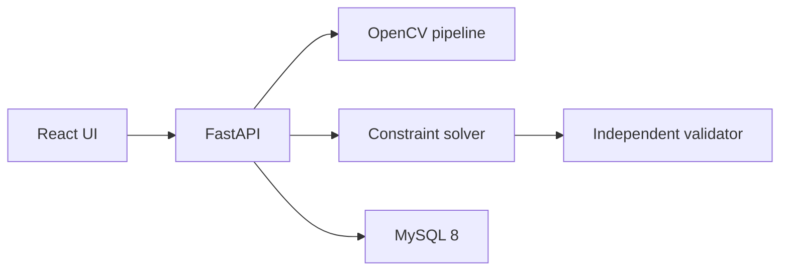

# Cat Puzzle Solver

Upload a screenshot of a colored cat-placement puzzle. The app finds the grid, lets you correct the reading, and solves the placement on your machine. Vision uses OpenCV. The solver is a constraint search. Nothing is sent to a paid AI API.

## Architecture



The browser talks to `/api`. In development, Vite proxies that path to the backend. In Docker, nginx does the same proxy, so the auth cookie stays on one origin.

## Stack

- React, TypeScript, Vite, Tailwind, React Router, Axios, React Query
- FastAPI, Pydantic, SQLAlchemy, Alembic, Uvicorn
- MySQL 8
- OpenCV, Pillow, NumPy
- Argon2 passwords and JWT sessions in HTTP-only cookies
- Pytest, Vitest, React Testing Library
- Docker Compose, with an AWS layout described in `docs/aws-deployment.md`

## Rules the solver uses

- Exactly one cat per row
- Exactly one cat per column
- Exactly one cat per color
- Cats cannot touch, including diagonally
- Cells marked X are blocked

The board must be square. 10×10 is the usual size. Other square sizes through 16×16 are supported. How the detector and the search work is written up in [docs/vision.md](docs/vision.md) and [docs/solver.md](docs/solver.md).

## Prerequisites

Ubuntu packages already used on this machine:

- Python 3.12
- Node.js 20 and npm
- Docker Engine and Docker Compose
- Git

The system MySQL service can stay stopped. Compose runs MySQL 8 and publishes port 3306.

## Install

From the repository root:

```bash
cp .env.example .env
# Put a real JWT secret and database password in .env before any shared deploy.
# The checked-in example uses placeholders. A local .env is gitignored.

python3 -m venv backend/.venv
backend/.venv/bin/pip install -r backend/requirements.txt
npm install --prefix frontend
```

Start the database:

```bash
docker compose up -d mysql
```

Apply the schema:

```bash
cd backend
.venv/bin/alembic upgrade head
```

## Run the app

Two terminals, from the repository root.

Backend:

```bash
cd backend
.venv/bin/uvicorn app.main:app --reload --host 127.0.0.1 --port 8000
```

Frontend:

```bash
cd frontend
npm run dev
```

- App: http://localhost:5173
- API: http://localhost:8000
- OpenAPI: http://localhost:8000/docs

Create an account, upload a PNG or JPEG screenshot, correct the grid if the confidence is low, then solve. Row and column numbers in the placement table start at 1.

Email verification and password reset are implemented. Without `SMTP_HOST`, messages are written to the backend log. For local development, `DEBUG_RETURN_TOKENS=true` also returns the reset token so you can open the link. Set that flag to `false` anywhere except your own machine.

## Tests

```bash
backend/.venv/bin/python -m pytest
npm test --prefix frontend
```

Pytest uses SQLite in memory and does not touch the MySQL data. The suite covers auth, user isolation, grid detection at more than one resolution, blocked cells, cats, perspective, noise, unique and multiple solutions, impossible boards, and the full upload-to-history flow.

Sample screenshots and their expected grids are in `tests/fixtures/`. Regenerate them with:

```bash
PYTHONPATH=backend backend/.venv/bin/python backend/scripts/generate_fixtures.py
```

## API

Authentication:

- `POST /api/auth/signup`
- `POST /api/auth/login`
- `POST /api/auth/logout`
- `GET /api/auth/me`
- `PATCH /api/auth/me`
- `POST /api/auth/change-password`
- `POST /api/auth/forgot-password`
- `POST /api/auth/reset-password`
- `POST /api/auth/verify-email`

Puzzles:

- `POST /api/puzzles/upload`
- `POST /api/puzzles/{id}/analyze`
- `GET /api/puzzles/{id}/image`
- `GET /api/puzzles/{id}/board`
- `PUT /api/puzzles/{id}/board`
- `POST /api/puzzles/{id}/solve`
- `GET /api/puzzles`
- `GET /api/puzzles/stats`
- `GET /api/puzzles/{id}`
- `DELETE /api/puzzles/{id}`
- `GET /api/puzzles/{id}/solutions`
- `GET /api/puzzles/{id}/solutions/{solution_id}`
- `GET /api/puzzles/{id}/solutions/{solution_id}/image`

Puzzle routes require the session cookie. A puzzle id owned by someone else returns 404.

## Docker

```bash
docker compose up --build
```

- Site through nginx: http://localhost:8080
- API direct: http://localhost:8000
- MySQL: localhost:3306

The database volume is `mysql_data`. Uploaded images use the `puzzle_storage` volume. The backend waits until MySQL is healthy, then runs Alembic.

## Troubleshooting

- **Port 3306 is taken.** Stop the other MySQL or change the host port in `docker-compose.yml`.
- **Login works in the API docs but not the UI.** Use the Vite URL, not the backend port. The cookie is set for the site that the browser calls.
- **Reset email never arrives.** SMTP is optional. Check the backend log, or use the token when `DEBUG_RETURN_TOKENS` is on.
- **The grid looks wrong.** The editor is the source of truth. Change colors, X marks, existing cats, and the size, then solve again. Low-confidence cells are flagged. Missing cells are left blank.
- **Solver says the color count does not match.** Merge colors that the camera split, or split a color the camera joined, until there is one color group per row.
- **`alembic upgrade` cannot connect.** Wait until `docker compose ps` shows MySQL as healthy.

## Configuration

See `.env.example`. Do not commit `.env`.

## Later

- Shared rate-limit store when more than one API worker is running
- S3 storage adapter, wired the way `docs/aws-deployment.md` describes
- SMTP in production with `DEBUG_RETURN_TOKENS=false` and `COOKIE_SECURE=true`
